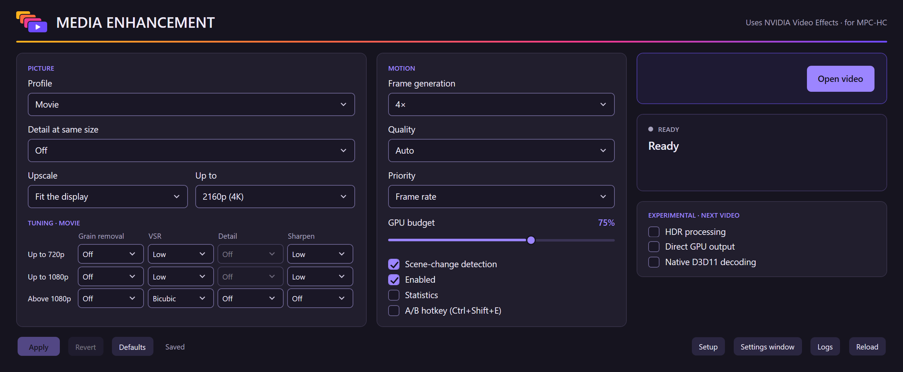
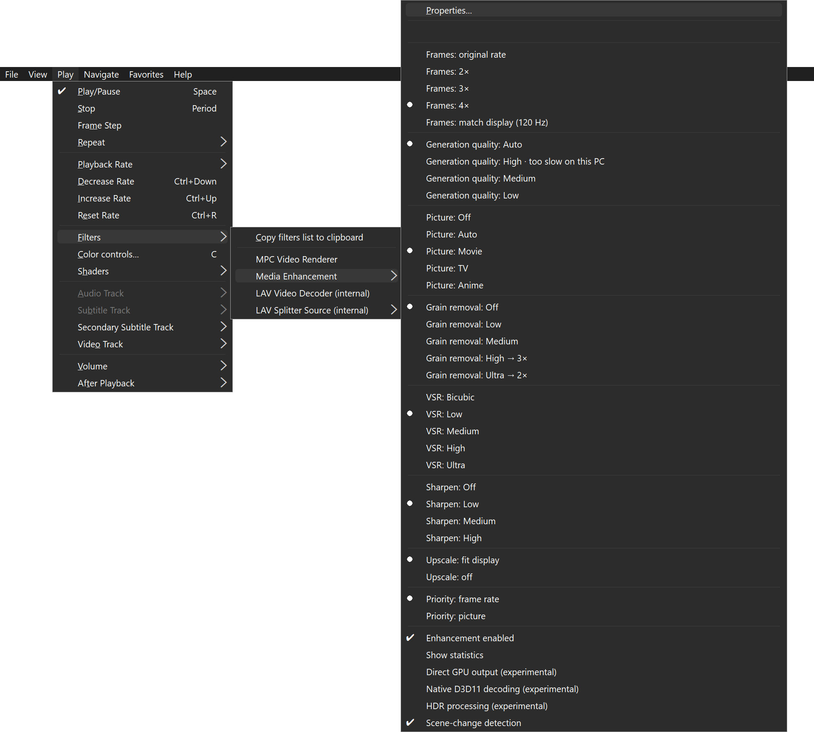
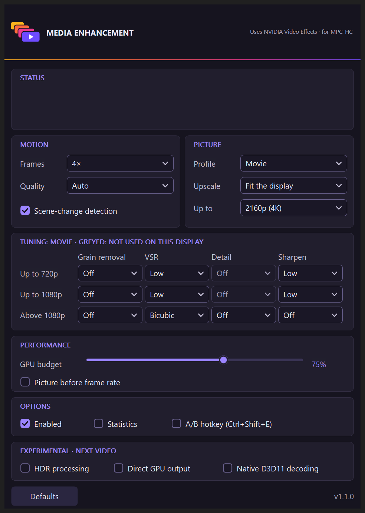
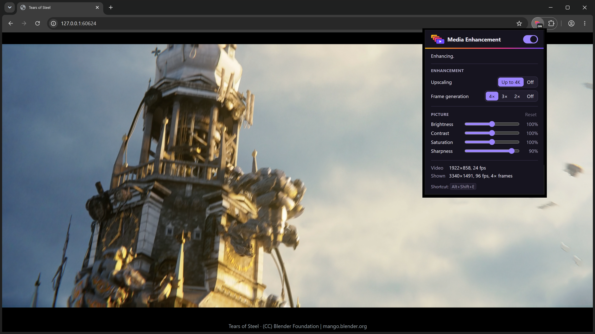

<h1>
  <picture>
    <source media="(prefers-color-scheme: dark)" srcset="docs/images/logo-wordmark-dark.svg">
    
  </picture>
</h1>

Media Enhancement improves video playback in MPC-HC on PCs with an NVIDIA RTX graphics card. It upscales video to your display with NVIDIA Video Super Resolution, can remove film grain and sharpen the picture, and can generate in-between frames for smoother motion (2×, 3×, 4× or matched to your display's refresh rate).

It works as a DirectShow filter between the video decoder and the video renderer, so MPC-HC and MPC Video Renderer stay unmodified.

A [browser extension](#browser-extension) brings upscaling, frame generation and picture controls to video played in Chrome, Edge and Firefox.

Media Enhancement is an independent project. It is not affiliated with, sponsored or endorsed by NVIDIA Corporation or the MPC-HC project.

## Download

Both are in the [latest release](../../releases/latest), whose notes list the SHA-256 checksums.

- **For MPC-HC:** the installer, `Media-Enhancement-Setup-1.1.0.exe`.
- **For Chrome, Edge and Firefox:** the extension, `Media-Enhancement-Browser-1.1.1-Chrome-Edge.zip` and `Media-Enhancement-Browser-1.1.1-Firefox.xpi`. See [Browser extension](#browser-extension).

## Requirements

- Windows 10 or Windows 11, 64-bit.
- An NVIDIA RTX graphics card with a current NVIDIA driver:
  - **Upscaling and picture effects:** RTX 20 series or newer.
  - **Frame generation:** RTX 40 or RTX 50 series.
- MPC-HC 2.8 or newer. Setup installs MPC-HC 2.8.4.49 when no MPC-HC is found.
- About 2 GB of free disk space, most of it for the NVIDIA runtime files.

## Install

1. Run the installer. Windows may show a SmartScreen warning because the installer is not code-signed. Continue only if you downloaded it from this repository's releases.
2. Setup installs Media Enhancement in Program Files, so Windows asks for administrator permission. Setup then adds the filter to MPC-HC and installs the Microsoft Visual C++ runtime if needed.
3. Open a video in MPC-HC.

## Use

The settings can be changed in three places. They all change the same settings, and most changes apply to the playing video straight away.

- **In MPC-HC:** Play › Filters › Media Enhancement. Properties in that menu opens the settings panel.
- **Control center:** the Media Enhancement app in the Start menu. It also shows the live status of the playing video.
- **Settings window:** Media Enhancement Settings in the Start menu, for quick changes.

The menu's Status line and the panel's status box show live figures while a video plays. They are left empty in these pictures. The pictures on this page show example settings, not the defaults: the Movie profile, 4× frame generation and the A/B hotkey off.

## Features

- **Profiles:**
  - Auto chooses Movie, TV or Anime for each video and uses the recommended levels for that kind of video.
  - Movie, TV and Anime each keep their own grain removal, upscaling, detail and sharpening levels for each video height, which you can change.
  - Off turns the picture treatment off.
- **Upscaling:** NVIDIA Video Super Resolution enlarges video to the display size. Video that is already the display size can get a detail pass instead.
- **Film grain removal and sharpening:**
  - Grain removal uses NVIDIA's effect.
  - Sharpening is the filter's own contrast-adaptive pass. It sharpens edges without halos.
- **Frame generation:** NVIDIA Video Frame Generation at 2×, 3× or 4×, matched to the display's refresh rate, or off. The quality can be Auto, High, Medium or Low, and the filter detects scene changes.
- **Automatic fit:**
  - The filter chooses the richest settings that fit a GPU time budget you can set.
  - It favours either frame rate or picture quality, as you choose.
  - It greys out settings that have no effect on your display.
  - It marks a choice that would lower frame generation with the rate it lowers to (for example "→ 3×"), and a choice that is too slow on your PC.
- **A/B hotkey:** compares the enhanced picture with the original while the video plays.
- **Experimental options**, off by default: HDR processing, direct GPU output to MPC Video Renderer, and native D3D11 decoding.

## Limits

- HDR video plays without enhancement unless the experimental HDR processing option is on.
- Interlaced video, very small (below 480×340) or very large (above 8K) video, and odd frame sizes play without enhancement.
- Frame generation is not available on RTX 20 and RTX 30 series cards. Upscaling and the picture effects still work.
- When the NVIDIA effects cannot run, video plays without enhancement and the status line says why.

## Uninstall

Use Settings › Apps › Installed apps › Media Enhancement › Uninstall, or Uninstall Media Enhancement in the Start menu. MPC-HC stays installed unless you choose to remove it.

## Browser extension

The browser extension enhances video that plays in a web page:

- **Upscaling:** it enlarges the picture to the size the video is shown at on your screen, up to 3840×2160, and sharpens it.
- **Frame generation:** it adds generated in-between frames, 2×, 3× or 4×, never more than your display's refresh rate.
- **Picture controls:** brightness, contrast, saturation and sharpness.

It runs on your graphics card through WebGPU, inside the page. It does not use MPC-HC or the NVIDIA effects, so it is not limited to NVIDIA cards.

### Install the extension

- **Chrome or Edge:**
  1. Download `Media-Enhancement-Browser-1.1.1-Chrome-Edge.zip` and unzip it to a folder you keep.
  2. Open `chrome://extensions` (in Edge, `edge://extensions`) and switch on Developer mode.
  3. Choose Load unpacked and select the folder.
- **Firefox:** download `Media-Enhancement-Browser-1.1.1-Firefox.xpi` and open it in Firefox, or choose Install Add-on From File on the `about:addons` page. Mozilla has signed it for installation outside the add-ons site.

### Use the extension

1. Play a video on a page.
2. Click the extension's icon and switch it on, or press Alt+Shift+E.
3. Choose upscaling (up to 4K, or off) and frame generation (4×, 3×, 2× or off), and set the picture controls if you like; Reset brings them back. The popup shows the video's size and frame rate and what is shown on the screen.

The extension shows fewer generated frames than you chose when your display's refresh rate cannot show them. When playback would not stay smooth, it steps down for a while: fewer generated frames first, then no upscaling, then the video as it is.

### Extension requirements

- Chrome or Edge 121 or newer, or Firefox 144 or newer, with WebGPU available. The browser versions tested are listed in the release notes.
- A graphics card that the browser can use for WebGPU. Frame generation at 4K needs a fast dedicated graphics card.

### Extension limits

- Video the page does not let other code read is left as it is: copy-protected streams, video from another site that does not allow it, and video files opened from your computer.
- HDR video is left to the browser, and so is video larger than 8K or smaller than 64 pixels in either dimension.
- Videos in embedded players (frames) are not found.
- Videos that the page scales, rotates or mirrors, or shows see-through, filtered or masked, are shown as they are, because the enhanced picture could not follow that styling. The same goes when the page's own styles hide the enhanced picture. The popup says so.
- The extension steps aside while the video's own controls show (also while the pointer rests on their bar) or its captions, in picture-in-picture (in Chrome and Edge; Firefox does not tell pages about its own picture-in-picture window), and when the bare video element is fullscreen. Most sites show fullscreen video inside their own player, where it works.
- With frame generation on, the picture is shown about one source frame later than the browser would show it (about 42 ms at 24 fps). The sound is not changed.
- While a page scrolls a video inside a scrolling area of its own (such as a feed), the enhanced picture is hidden until the scrolling stops.
- When the browser passes too few of a video's frames to pages, the extension shows the video as it is, since the browser's own picture has every frame, and the popup says why. Firefox tells pages about new frames only about 25 times a second, so in Firefox the extension reads Firefox's frame counter on each display refresh instead: 24, 30 and 60 fps video is enhanced (tested with Firefox 160 on 60 and 120 Hz displays at normal speed; other frame rates were not tested). A new video in Firefox is shown as it is for about a second (three at most) while the popup says the extension is checking its frames. Where Firefox's frame counter is switched off (`media.video_stats.enabled`) or made up (`privacy.resistFingerprinting`), the extension works from Firefox's frame reports alone: video above 25 fps is shown as it is, 24 fps video holds briefly about once a second, and after Firefox has withheld frames once, later videos on the same page are checked for about two seconds before the enhanced picture is shown.
- Brightness, contrast and saturation also apply while the extension steps aside for the video's own controls or captions, when the browser withholds frames, when the graphics card is busy, and for video the page may not read (another site's, or a file from your computer). They then also apply to the video's own captions and controls, so at low brightness or contrast captions are dimmer. In the other cases above, and for copy-protected video, they do not apply. Sharpness applies only to the enhanced picture.
- In Firefox, a video with oval corners is drawn by Firefox a little narrower at the sides than the page sets. The enhanced picture fills the whole oval, and while the extension shows the video as it is, brightness, contrast and saturation also apply to the thin strips of page at the sides.
- If a stream's frame rate drops sharply while it plays (from 60 to 15 fps, say), no frames are generated for the rest of that video.

### Extension privacy

The extension runs only on your computer and does not collect or send any data. It keeps only its own settings, in the browser. It asks for the active-tab, scripting and storage permissions, and runs on a page only when you switch it on there.

## Licence

You may download and use Media Enhancement free of charge. All other rights are reserved. No licence is granted to copy, modify or redistribute the program, and its source code is not published.

The installer includes third-party components under their own licences. The NVIDIA runtime libraries are included for use with Media Enhancement only. See [THIRD-PARTY-NOTICES.md](THIRD-PARTY-NOTICES.md).

The browser extension is licensed in the same way. It contains code ported from AMD FidelityFX Super Resolution 1 and from Matt Pettineo's Catmull-Rom sampling (both MIT licence), and follows OpenCV's implementation of DIS optical flow (Apache License 2.0); see [THIRD-PARTY-NOTICES.md](THIRD-PARTY-NOTICES.md).

The video in the browser extension picture is from *Tears of Steel*, (CC) Blender Foundation | mango.blender.org, licensed under [CC BY 3.0](https://creativecommons.org/licenses/by/3.0/).

NVIDIA, GeForce and RTX are trademarks or registered trademarks of NVIDIA Corporation in the United States and other countries. Other product names are trademarks of their owners.
