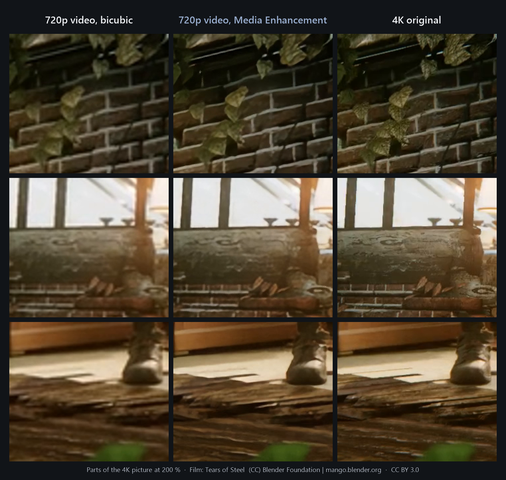
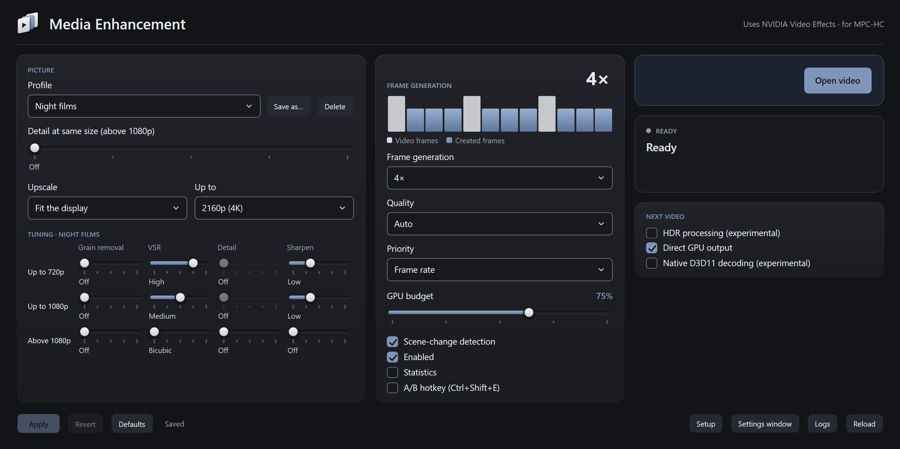
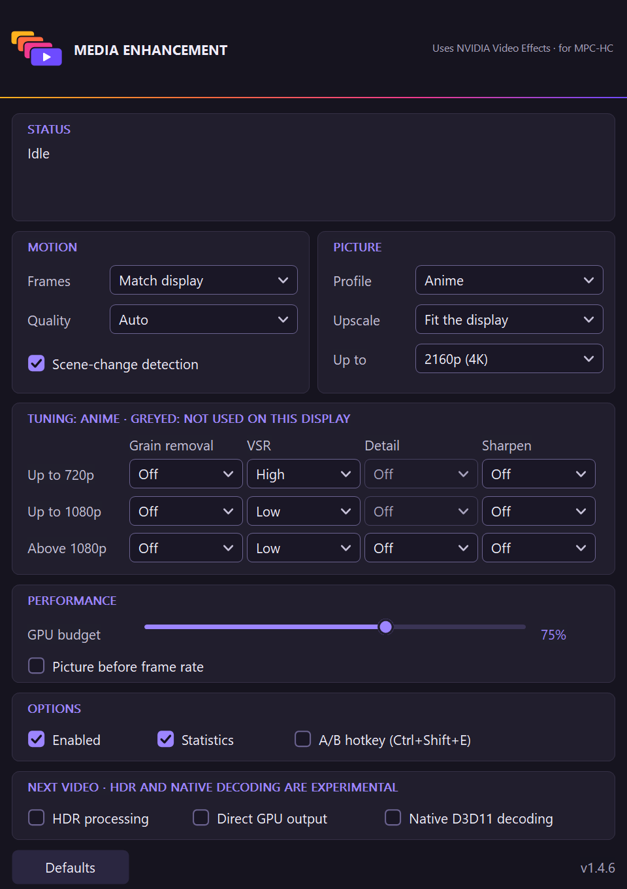
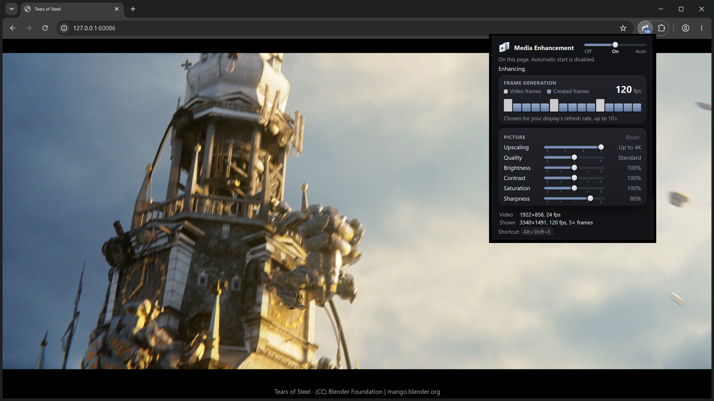
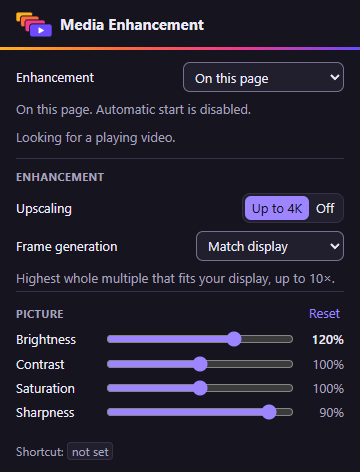
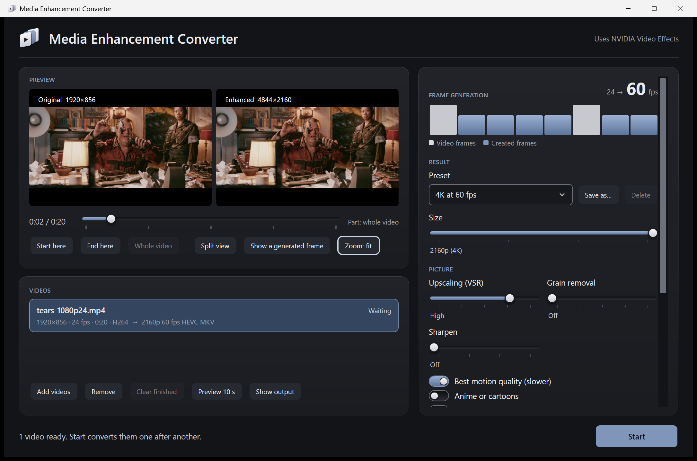
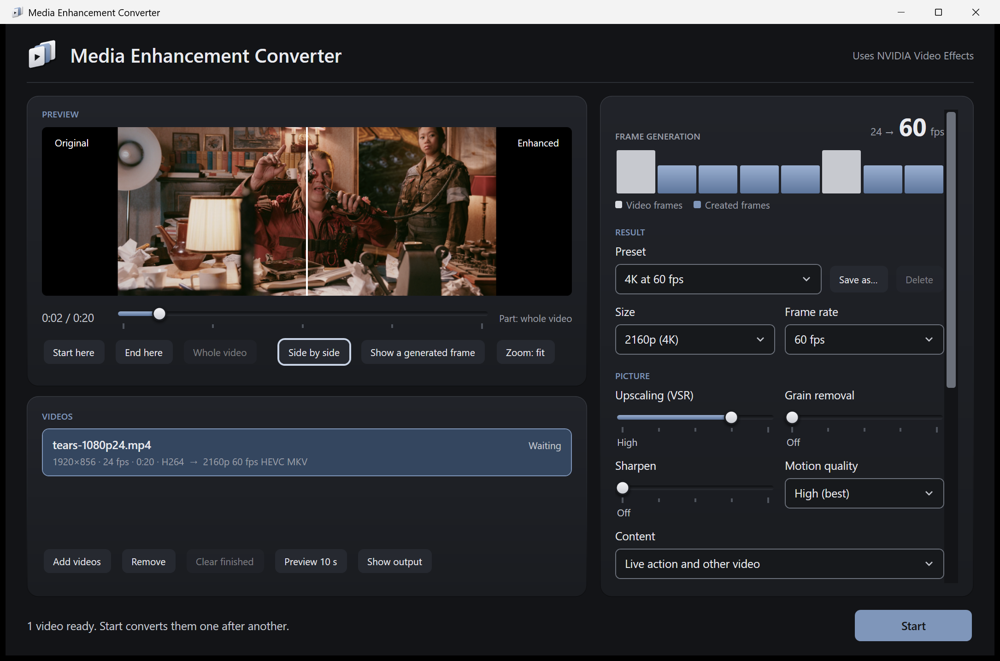

<h1>
  <picture>
    <source media="(prefers-color-scheme: dark)" srcset="docs/images/logo-wordmark-dark.svg">
    
  </picture>
</h1>

Media Enhancement improves video playback in MPC-HC on PCs with an NVIDIA RTX graphics card. It upscales video to your display with NVIDIA Video Super Resolution, can remove film grain and sharpen the picture, and can generate in-between frames for smoother motion (2× to 10×, or matched to your display's refresh rate).

https://github.com/user-attachments/assets/1b4fbe3c-7299-45dd-8be0-74865614be87

*One picture in three strips. Left: the original at 24 fps, enlarged with bicubic. Middle and right: Media Enhancement at 60 fps and at 120 fps, with Video Super Resolution and frame generation (the converter's 4K settings). The 120 fps strip needs a 120 Hz display; on a 60 Hz display it looks like the 60 fps strip. Film: Tears of Steel, (CC) Blender Foundation | mango.blender.org, CC BY 3.0.*

**Upscaling a 720p video to 4K:**

https://github.com/user-attachments/assets/3fd3199e-ceec-4056-8556-0a1c6fc48b23

*Part of the picture at 200 %. Left of the divider: the 720p video enlarged with bicubic. Right of it: enlarged by Media Enhancement with Video Super Resolution. The divider moves by itself, because a page here cannot hold a slider to drag; pause the video to compare.*

*The three parts of that shot where Media Enhancement gained most, at 200 %. Measured against the 4K original, it is 1.7 to 3.0 dB closer there than bicubic (PSNR) and keeps edges 78 to 86 % as steep as the original's; bicubic keeps 40 to 50 %. Over the whole picture it is 1.4 dB closer, with edges 58 % as steep against 37 %. The 720p video was made from the 4K film (Tears of Steel, from 183.5 s) and enlarged with converter 0.6.8, once with its plain bicubic and once with Video Super Resolution at High.*

It works as a DirectShow filter between the video decoder and the video renderer, so MPC-HC and MPC Video Renderer stay unmodified.

A [converter](#converter) applies the same enhancements to video files, so the result plays anywhere. A [browser extension](#browser-extension) brings upscaling, frame generation and picture controls to video played in Chrome, Edge, Brave and Firefox.

Media Enhancement is an independent project. It is not affiliated with, sponsored or endorsed by NVIDIA Corporation or the MPC-HC project.

## Download

All are in the [latest release](../../releases/latest), whose notes list the SHA-256 checksums.

- **For MPC-HC:** the installer, `Media-Enhancement-Setup-1.6.2.exe`. It can also install the converter (an option in Setup). See [Converter](#converter).
- **For Chrome, Edge, Brave and Firefox:** the extension. For Chrome, Edge and Brave it is `Media-Enhancement-Browser-1.5.1-Chrome-Edge-Brave.zip`. For Firefox, install it from [Firefox Add-ons](https://addons.mozilla.org/firefox/addon/media-enhancement/) (version 1.5.1, reviewed by Mozilla). See [Browser extension](#browser-extension).

## Requirements

- Windows 10 or Windows 11, 64-bit.
- An NVIDIA RTX graphics card with a current NVIDIA driver:
  - **Upscaling and picture effects:** RTX 20 series or newer.
  - **Frame generation:** RTX 40 or RTX 50 series.
- MPC-HC 2.8 or newer. Setup downloads and installs MPC-HC 2.8.5 when no MPC-HC is found.
- An internet connection when Setup has to download MPC-HC (22 MB) or the Microsoft Visual C++ runtime (18 MB); the installer no longer carries them.
- About 1 GB of free disk space, most of it for the NVIDIA runtime files.

## Install

1. Run the installer. Windows may show a SmartScreen warning because the installer is not code-signed. Continue only if you downloaded it from this repository's releases.
2. Setup installs Media Enhancement in Program Files, so Windows asks for administrator permission. Setup then adds the filter to MPC-HC and downloads and installs the Microsoft Visual C++ runtime if needed. Tick **Media Enhancement Converter** on the options page to install the converter as well; it gets its own Start-menu shortcut.
3. Open a video in MPC-HC.

## Use

The settings can be changed in three places. They all change the same settings, and most changes apply to the playing video straight away.

- **In MPC-HC:** Play › Filters › Media Enhancement. The menu lists the status, Enhance video (the on/off switch, with its key), and Picture, Frame generation and Options. Each of these three opens its own menu, with a side branch for each group of choices. Properties in that menu opens the settings panel.
- **Control center:** the Media Enhancement app in the Start menu. It also shows the live status of the playing video.
- **Compact settings:** a small settings window for quick changes. Open Media Enhancement Settings in the Start menu, or Compact settings in the control center.

The panel's status box shows live figures while a video plays. The pictures of the control center and the settings panel were taken with version 1.5.8 with no video playing, so the status box is empty. They show the Movie profile with its default levels and frame generation at 4×. Version 1.6.2 arranges the control center differently: the player line and Open video are in its header, and the status card has a bar for the GPU time.

## Features

- **Profiles:**
  - Auto chooses Movie, TV or Anime for each video and uses the recommended levels for that kind of video.
  - Movie, TV and Anime each keep their own grain removal, upscaling, detail and sharpening levels for each video height, which you can change.
  - Off turns the picture treatment off.
  - **Custom profiles:** Save as saves the levels shown, the frame rate and what to keep when the GPU is short under a name of your own; choose it from the profile list (also under Picture in the MPC-HC menu) to use it again, and Delete removes it. Up to 32. Apply saves changes to a custom profile; Cancel and Undo changes drop them.
- **Sliders and switches:** every setting with steps is a slider, with a mark for each step, and every on/off setting is a switch. The profile is the only list. A level stronger than the strongest one the project's picture measurements accepted is shown in red; you can still choose it. Frame generation is a strip of bars: tall bars are the video's frames, short bars the generated ones, red past what your display can show. Click a slider where you want it, or drag it.
- **Upscaling:** NVIDIA Video Super Resolution enlarges video to the display size. The Size slider goes from Original size to Up to 4320p (8K). Video that is already the display size can get a detail pass instead.
- **Film grain removal and sharpening:**
  - Grain removal uses NVIDIA's effect.
  - Sharpening is the filter's own contrast-adaptive pass. It sharpens edges without halos and leaves grain, noise and flat areas as they are.
- **Frame generation:** NVIDIA Video Frame Generation at 2× to 10×, matched to the display's refresh rate, or off. The multiples from 7× to 10× are for 240 Hz displays. The quality can be Auto, High, Medium or Low.
- **Scene cuts and fast motion:** at a scene cut, and where the picture changes too fast for clean in-between frames, the filter shows source frames instead of generated ones.
- **Bars and text that change in place:** at High quality, where something changes in place and the motion does not explain it, such as the bars of an audio waveform, the filter shows the nearer source frame instead of generated ones. It does this only when the change covers at most a tenth of the picture; on larger changes, such as water spray, NVIDIA's generated frames measured better.
- **Adjust to the GPU automatically:**
  - The filter chooses the richest settings that fit a GPU time budget you can set.
  - When the GPU is short, it keeps the frame rate, or the picture if you switch on Keep the picture when the GPU is short.
  - It greys out settings that have no effect on your display.
  - It marks a choice that would lower frame generation with the rate it lowers to (for example "→ 3×"), and a choice that is too slow on your PC.
  - **You can switch it off** (Adjust to the GPU automatically, in the menu's Frame generation branch, the settings panel's GPU group and the control center's GPU box). The frame generation multiple, the generation quality and the picture levels then play exactly as you chose them, for example Medium at 6×, also when the filter's cost estimate says they will not fit; generated frames that would come late are left out instead. A fixed multiple still stops at what the display can show.
- **The status says what holds frame generation back:** when the display, the GPU budget or the renderer limits the generated frames, when late frames lowered them, or while the model is still loading, the status line names it, for example "no frame generation: display limit (60 Hz)". It shows in the control center, the settings panel and the MPC-HC menu.
- **On/off hotkey:** turns the enhancement off and on while the video plays, so you can compare. The key is Ctrl+Shift+E. If another program uses it, the key is Ctrl+Alt+E. The menu and the On/off hotkey switch show the key in use.
- **Direct GPU output** (on by default): with MPC Video Renderer in its D3D11 mode, the filter hands its frames over as GPU textures, without a copy through system memory.
- **Experimental options**, off by default: Enhance HDR video and native D3D11 decoding.
- **Video memory:** when frame generation steps down to a lower quality, the higher quality's model is freed after 3 minutes.

## Limits

- HDR video plays without enhancement unless the experimental Enhance HDR video option is on.
- Interlaced video, very small (below 480×340) or very large (above 8K) video, and odd frame sizes play without enhancement.
- Frame generation is not available on RTX 20 and RTX 30 series cards. Upscaling and the picture effects still work.
- When the NVIDIA effects cannot run, video plays without enhancement and the status line says why.

## Uninstall

Use Settings › Apps › Installed apps › Media Enhancement › Uninstall, or Uninstall Media Enhancement in the Start menu. MPC-HC stays installed unless you choose to remove it.

## Browser extension

The browser extension enhances video that plays in a web page:

- **Upscaling:** it enlarges the picture to the size the video is shown at on your screen, up to 3840×2160 or a smaller size you choose (2560×1440 or 1920×1080), and sharpens it. The quality can be Fast (bilinear, the least work for the graphics card), Standard (Catmull-Rom, the default) or High (edge-adaptive, AMD FidelityFX Super Resolution 1 EASU).
- **Frame generation:** it adds generated in-between frames, 2× to 10× or matched to your display, never more pictures than your display's refresh rate. Match display, the default, generates enough frames for a new picture on every refresh, 5× for 24 or 25 fps video on a 120 Hz display, and none when a frame lasts less than 1.75 refreshes (50 fps video on a 60 Hz display, for example). At a scene cut it shows the two shots one after the other instead of blending them. It follows fast tickers, sliding titles, thin objects and bars, and where something changes in place and the motion does not explain it, such as the bars of an audio waveform, it shows the video's own frames.
- **Picture controls:** brightness, contrast, saturation and sharpness. Sharpness turns red above the strongest setting that kept edges and flat areas within the measured limits on the test films: 90 % with Fast upscaling, 80 % with Standard and 60 % with High. Its default is 80 %, or 60 % with High.
- **Frame rate on the toolbar button:** while the extension enhances a video, its toolbar button shows the frame rate. On blue, it is the pictures a second the extension draws; on grey, the video's own frame rate while the extension shows the video as it is; 0 while the video is paused or loading.

It runs on your graphics card through WebGPU, inside the page. It does not use MPC-HC or the NVIDIA effects, so it is not limited to NVIDIA cards.

**Firefox on Windows:** with its system compositor, Firefox put only part of the generated frames on the screen: at 3840×2160 on a 120 Hz display, 73 a second of 24 fps video at 5× instead of 120. The extension therefore switches that compositor off (the setting `gfx.webrender.compositor`) when it is installed. Restart Firefox once; until then the popup reminds you. Firefox needs the compositor for HDR video, so the popup has a switch, **Allow HDR video** (off by default), that gives Firefox its own setting back after a restart. Firefox also restores its own setting when the extension is disabled or removed.

The pictures were taken with version 1.5.0, which has the same popup as 1.5.1. The popup:

### Install the extension

- **Chrome, Edge or Brave:**
  1. Download `Media-Enhancement-Browser-1.5.1-Chrome-Edge-Brave.zip` and unzip it to a folder you keep.
  2. Open `chrome://extensions` (in Edge, `edge://extensions`; in Brave, `brave://extensions`) and switch on Developer mode.
  3. Choose Load unpacked and select the folder.
- **Firefox:** install it from [Firefox Add-ons](https://addons.mozilla.org/firefox/addon/media-enhancement/). The version there is 1.5.1, the same as for Chrome, Edge and Brave; Mozilla has reviewed it, and Firefox keeps it up to date by itself. The listing is a new add-on: if you installed the older `Media-Enhancement-Browser-1.4.7-Firefox.xpi` from a release here, remove it first on the `about:addons` page (that file does not update by itself). On Windows, restart Firefox once after installing.

### Use the extension

1. Play a video on a page.
2. Click the extension's icon and move the slider at the top to **On**, or press Alt+Shift+E.
3. Set upscaling (off, or up to 1080p, 1440p or 4K) and its quality, frame generation (off, 2× to 10×, or Match display, the default, which chooses the multiple for your display's refresh rate) and the picture controls if you like. They are all sliders: click where you want it, or drag it. Reset brings the picture controls back. The popup shows the video's size and frame rate and what is shown on the screen.

The extension switches on by itself (**Auto**, the default): when you install it, the browser asks you to let it access all sites. It then switches on when a video plays with its sound on, on any site. It leaves muted videos alone until you switch their sound on, and it also leaves small videos and short previews alone. If you switch it off in a tab, it stays off there until the tab shows another page. Move the slider at the top to **Off** or **On** to switch Auto off, and to **Auto** to switch it on again.

The extension shows fewer generated frames than you chose when your display's refresh rate cannot show them. When playback would not stay smooth, it steps down for a while: fewer generated frames first, then no upscaling, then the video as it is.

### Extension requirements

- Chrome or Edge 121 or newer, Brave on Chromium 121 or newer, or Firefox 144 or newer, with WebGPU available. The browser versions tested are listed in the release notes.
- A graphics card that the browser can use for WebGPU. Frame generation at 4K needs a fast dedicated graphics card.

### Extension limits

- Video the page does not let other code read is left as it is: copy-protected streams, video from another site that does not allow it, and video files opened from your computer.
- HDR video is left to the browser, and so is video larger than 8K or smaller than 64 pixels in either dimension.
- Videos in embedded players (frames) are not found.
- Videos that the page scales, rotates or mirrors, or shows see-through, filtered or masked, are shown as they are, because the enhanced picture could not follow that styling. The same goes when the page's own styles hide the enhanced picture. The popup says so.
- The extension steps aside while the video's own controls show (also while the pointer rests on their bar) or its captions, in picture-in-picture (in Chrome and Edge; Firefox does not tell pages about its own picture-in-picture window), and when the bare video element is fullscreen. Most sites show fullscreen video inside their own player, where it works.
- With frame generation on, the picture is shown about one source frame later than the browser would show it (about 42 ms at 24 fps). The sound is not changed.
- While a page scrolls a video inside a scrolling area of its own (such as a feed), the enhanced picture is hidden until the scrolling stops.
- When the browser passes too few of a video's frames to pages, the extension shows the video as it is, since the browser's own picture has every frame, and the popup says why. Firefox tells pages about new frames only about 25 times a second, so in Firefox the extension reads Firefox's frame counter on each display refresh instead: 24, 25, 30, 50 and 60 fps video is enhanced (tested with Firefox 160 on 60 and 120 Hz displays at normal speed; other frame rates were not tested). With 50 fps video on a 60 Hz display, one of four test runs stopped reading the frame counter at its end, after about 40 seconds; the cause was not found. A new video in Firefox is shown as it is for about a second (three at most) while the popup says the extension is checking its frames. Where Firefox's frame counter is switched off (`media.video_stats.enabled`) or made up (`privacy.resistFingerprinting`), the extension works from Firefox's frame reports alone: video above 25 fps is shown as it is, 24 fps video holds briefly about once a second, and after Firefox has withheld frames once, later videos on the same page are checked for about two seconds before the enhanced picture is shown.
- Brightness, contrast and saturation also apply while the extension steps aside for the video's own controls or captions, when the browser withholds frames, when the graphics card is busy, and for video the page may not read (another site's, or a file from your computer). They then also apply to the video's own captions and controls, so at low brightness or contrast captions are dimmer. In the other cases above, and for copy-protected video, they do not apply. Sharpness applies only to the enhanced picture.
- In Firefox, a video with oval corners is drawn by Firefox a little narrower at the sides than the page sets. The enhanced picture fills the whole oval, and while the extension shows the video as it is, brightness, contrast and saturation also apply to the thin strips of page at the sides.
- If a stream's frame rate drops sharply while it plays (from 60 to 15 fps, say), no frames are generated for the rest of that video.
- Where the picture moves too fast for clean in-between frames, the extension shows the source frames for that moment instead of generated ones, so fast action can look less smooth than the rest of the video.
- A scene cut can be missed when the two pictures still match after motion, or when it comes in the middle of fast action; the two frames are then blended for one frame interval. A flickering passage or a fade can be taken for a cut; the picture then holds for one frame interval, as without frame generation.

### Extension privacy

The extension runs only on your computer and does not collect or send any data. It keeps only its own settings, in the browser. It asks for the active-tab, scripting and storage permissions, and in Firefox also for browser settings, which it uses only to switch Firefox's system compositor off or back on (see Firefox on Windows above). When you install it, the browser asks you to give it access to all websites, which Auto, the default, needs. The extension then adds a small script to every page you open, which only notices when a video plays, and it switches the enhancement on in a page where a large video plays with its sound on. As when you switch it on yourself, the page can see the enhanced picture and the settings it uses. Choosing Off or On switches Auto off; you can take the access back in the browser's extension settings.

## Converter

A preview. It converts a video file to a new file with the same enhancements (upscaling, grain removal, sharpening and frame generation), so the result plays anywhere, also on devices without an NVIDIA card.

- **Preview before converting.** The original frame is on the left and the enhanced frame on the right. Move the seek bar to any scene, zoom in with the mouse wheel (up to 64×) and drag to move the picture. "Show a generated frame" shows a frame made by frame generation.
- **Split view** shows one picture with a divider you can drag between the original and the enhanced side.
- **Choose the result:** a preset (the only list), or your own settings: the size, frame rate, upscaling, grain removal, sharpening, codec and quality are sliders, and best motion quality, MP4 format, faster encoding and saving beside each video are switches. **Save as** keeps your own combination as a preset; **Delete** removes it.
- **Anime:** switch on Anime or cartoons, and drawings that are held for two or three frames are filled with generated frames.
- **Trim:** "Start here" and "End here" convert only part of a video.
- **Estimates:** "Preview 10 s" converts ten seconds from the seek bar's position and estimates the size and time of the whole conversion.
- **Keep still text and overlays steady** keeps text, logos and game displays steady in generated frames. It is off by default and was measured only on game recordings at 1920×1080 and 2×.
- **Bars and text that change in place** get the same check as in MPC-HC when Best motion quality is on (the default).

- Install it with Setup 1.6.2: tick the Media Enhancement Converter option. It gets its own Start-menu shortcut. The original files are not changed.
- `MediaEnhancementConvert.exe` in the converter's folder is the same engine for the command line.
- Tested: the engine's 20-case suite on an RTX 5060 with a 120 Hz display (version 0.6.8) and on an RTX 4070 Laptop GPU with a 240 Hz display (version 0.6.0). The pictures show version 0.6.3; since 0.6.8 the window is wider and has its settings in two columns.
- It includes FFmpeg 9.0 libraries (LGPL version 3, unchanged).

## Licence

You may download and use Media Enhancement free of charge. All other rights are reserved. No licence is granted to copy, modify or redistribute the program, and its source code is not published.

The installer includes third-party components under their own licences. The NVIDIA runtime libraries are included for use with Media Enhancement only. See [THIRD-PARTY-NOTICES.md](THIRD-PARTY-NOTICES.md).

The browser extension is licensed in the same way. It contains code ported from AMD FidelityFX Super Resolution 1 and from Matt Pettineo's Catmull-Rom sampling (both MIT licence), and follows OpenCV's implementation of DIS optical flow (Apache License 2.0); see [THIRD-PARTY-NOTICES.md](THIRD-PARTY-NOTICES.md).

The video in the samples at the top and in the browser extension and converter pictures is from *Tears of Steel*, (CC) Blender Foundation | mango.blender.org, licensed under [CC BY 3.0](https://creativecommons.org/licenses/by/3.0/).

NVIDIA, GeForce and RTX are trademarks or registered trademarks of NVIDIA Corporation in the United States and other countries. Other product names are trademarks of their owners.
